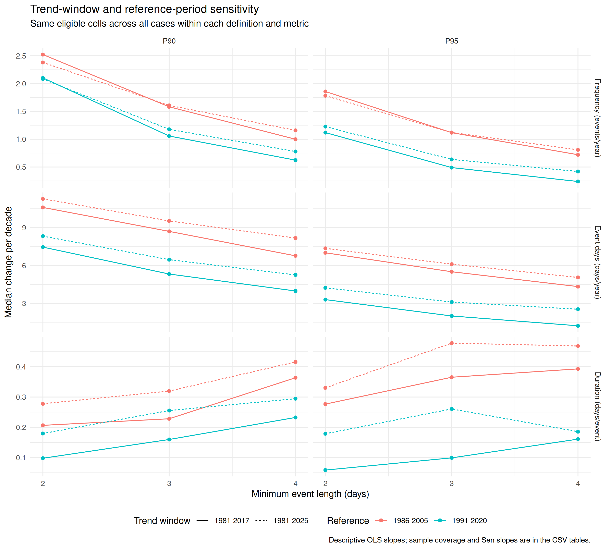

# Warm-spell trends and definition sensitivity in R

An extension of **Mohammad Salloum's MSc methodology**: how did warm-spell frequency and duration change, and how do the results depend on the event definition, reference period and trend window?

The workflow uses base R, **jsonlite** and **ggplot2**. **digest** verifies archived inputs; **sandwich** is used in the checks.

## Connection to the MSc thesis

*Climate Change Consequences and Scenarios: Syria as Case Study* (University of Tübingen, 2021, section 3.3.5, p. 45) used P90/P95 thresholds, minimum lengths of 2/3/4 days and the **1986–2005 reference**. This project retains those choices and the original extraction rectangle.

The primary analysis extends to **1981–2025**, retaining the thesis reference. POWER meteorological data begin in 1981; 2025 is the latest complete calendar year at preparation. The shared historical trend window is therefore 1981–2017. **1991–2020 is a reference-sensitivity check**, not a replacement justified by assumed greater accuracy.

The thesis describes daily mean temperature from Berkeley Earth and GHCNd. This project uses daily maximum temperature from POWER/MERRA-2 to study daytime warm extremes. It is a methodological extension, not a numerical reproduction or validation of the original counts or future scenarios.

## Primary results

**1981–2025; reference 1986–2005.** The primary data contain 1,643,600 daily records, 27,000 annual index rows and 1,800 planned trend cases. All 1,800 primary p-values are estimable.

<!-- RESULTS_TABLE_START -->
| Definition | Frequency OLS | Frequency Sen | Event days OLS | Mean duration OLS |
| --- | ---: | ---: | ---: | ---: |
| P90, 2+ days | 2.3801 | 2.3810 | 11.2806 | 0.2778 |
| P90, 3+ days | 1.6080 | 1.6667 | 9.5323 | 0.3198 |
| P90, 4+ days | 1.1594 | 1.1111 | 8.1739 | 0.4158 |
| P95, 2+ days | 1.7819 | 1.6667 | 7.3577 | 0.3304 |
| P95, 3+ days | 1.1206 | 1.0000 | 6.1034 | 0.4782 |
| P95, 4+ days | 0.8096 | 0.5882 | 5.0540 | 0.5133 |

Values are spatial medians of cell-specific changes per decade, not an area-average fitted trend. Units are events/year per decade, event-days/year per decade and days/event per decade.

| Definition | Frequency: BY cells | Event days: BY cells | Duration: BY cells |
| --- | ---: | ---: | ---: |
| P90, 2+ days | 99/100 | 100/100 | 75/100 |
| P90, 3+ days | 99/100 | 100/100 | 60/100 |
| P90, 4+ days | 97/100 | 98/100 | 56/100 |
| P95, 2+ days | 100/100 | 100/100 | 81/100 |
| P95, 3+ days | 97/100 | 99/100 | 77/100 |
| P95, 4+ days | 90/100 | 94/100 | 60/100 |

BY counts use one family of all 1,800 planned primary cases, including any unestimable cases. Denominators are cells with estimable slopes. Cells and nested definitions are correlated; counts are descriptive. Full precision is retained in `definition_summary.csv`.
<!-- RESULTS_TABLE_END -->

All 600 cell–definition slopes are positive for each metric. After BY, 582/600 frequency cases, 591/600 event-day cases and 409/600 conditional-duration cases pass the 0.05 threshold. These results are conditional on the chosen product and reference; the limitations below remain material.


## Trend-window and reference sensitivity

The same input series and event definitions are evaluated under four combinations. **Example: P90, 3+ days**, spatial median OLS changes per decade:

| Trend window | Reference | Frequency | Event days | Mean duration |
| --- | --- | ---: | ---: | ---: |
| 1981-2017 | 1986-2005 | 1.583 | 8.702 | 0.228 |
| 1981-2025 | 1986-2005 | 1.608 | 9.532 | 0.320 |
| 1981-2017 | 1991-2020 | 1.057 | 5.324 | 0.160 |
| 1981-2025 | 1991-2020 | 1.177 | 6.462 | 0.255 |

All six definitions and all three metrics are included in the CSV tables and figure. Summary comparisons use the same eligible cells across the four cases, separately within each definition and metric. The matched duration set ranges from 53 to 100 cells by definition. Each case's own eligible-cell summaries are also saved.

Thresholds are fitted from the complete selected reference period. Events are detected over the full 1981–2025 input before annual trend-window selection, so changing the fit window does not create artificial record edges at 2017. The 1991–2020 reference uses its complete data even for the shorter trend window. HAC lag 3 and the 15-year eligibility rule are held fixed; the additional comparison reports descriptive OLS/Sen slopes, not a new family of significance tests.

For P90/3+, the full-period frequency median is 1.608 with the thesis reference and 1.177 with the recent reference. Reference choice changes effect sizes and statistical evidence; a larger significant-cell count does not establish greater temperature accuracy.



## Other checks

HAC bandwidth sensitivity: numbers of BY cases under each lag, with a separate 1,800-case adjustment for each bandwidth:

| Metric | Lag 2 | Lag 3: primary | Lag 6 |
| --- | ---: | ---: | ---: |
| Frequency | 587 | 582 | 587 |
| Event days | 594 | 591 | 591 |
| Mean duration | 400 | 409 | 418 |

Slopes and eligible samples are unchanged across bandwidths. Equal totals may conceal different cells; `hac_lag_sensitivity.csv` records decision changes relative to lag 3. Bandwidth checks do not establish finite-sample interval coverage.

Minimum-year rules of 10, 15 and 20 retain all 600 duration fits with the primary reference and give the same primary results. Their tables are retained; no duplicate comparison map is needed.

## One-site ERA5-Land comparison

The site follows a fixed spatial rule: the POWER cell closest to the rectangle midpoint, using cosine-scaled longitude distance and a southern-latitude tie break: **38.75°E, 34.50°N**. The nearest ERA5-Land center is approximately 38.80°E, 34.50°N and has a different 0.1° footprint.

ERA5-Land was accessed through Open-Meteo with the model explicitly selected, UTC days, nearest-cell selection and no additional API elevation downscaling. Its raw response and SHA-256 metadata are bundled. Both products use 1986–2005 for the spell comparison.

| Diagnostic: 1981–2025 | POWER OLS | ERA5-Land OLS |
| --- | ---: | ---: |
| Annual mean daily Tmax: °C/decade | 0.428 | 0.604 |
| P90/3+ frequency: events/year per decade | 1.701 | 2.348 |

Both directions agree, while magnitudes differ. Annual mean Tmax is a check without percentile thresholds; the spell comparison uses product-specific thresholds and retains their sampling limitation. This is a descriptive nearest-cell check, not regional homogeneity testing or independent station validation.


## Conclusion

The new analysis is qualitatively consistent with the thesis' reported historical increase in hot days (pp. 49–51). It adds a reproducible spatial analysis through 2025, explicit event accounting, uncertainty checks, and controlled comparisons of reference and trend-window choices.

Frequency and event-day increases persist across the two references and trend windows. Conditional-duration results depend more strongly on the reference and available sample. The findings support a methodological continuation of the thesis; they do not verify its original numerical results or future scenario estimates, and do not establish which product is locally more accurate.

## Run

From the repository root:

```sh
Rscript install_dependencies.R
Rscript run_analysis.R
```

Or in R:

```r
source("install_dependencies.R")
source("run_analysis.R")
```

For a complete run followed by implementation checks:

```r
source("install_dependencies.R")
source("tests/run_checks.R")
```

The checks invoke the analysis themselves. A verified bundled snapshot takes precedence over the RDS cache; inputs without a snapshot use cache then API. Changing area or input years can require downloading new data. Settings are at the top of `Heat.R`. The specific period/reference or one-site checks are skipped with a message when required years or site settings are unavailable. To disable only the optional POWER archive hash check, set `options(warmspell.verify_snapshot = FALSE)`.

Checked with R 4.3.3, jsonlite 1.8.8, ggplot2 3.4.4, digest 0.6.39 and sandwich 3.1.0. See `sessionInfo.txt` and `checks.txt`.

## Data and methods

| Choice | Specification |
| --- | --- |
| Primary input | POWER T2M_MAX, °C, UTC; 1981–2025 |
| Domain | 36–42°E, 32.5–37°N; 100 native cells, 0.625° longitude × 0.5° latitude |
| Primary reference | 1986–2005; alternative 1991–2020 |
| Thresholds | Calendar-day P90/P95; circular ±2-day window; quantile type 8 |
| Leap day | Excluded from fitting; threshold interpolated from 28 February and 1 March; observed day retained |
| Event | Maximal consecutive run strictly above the threshold, lasting at least 2/3/4 days |
| Trends | OLS change per decade; Sen slope as a descriptive check |
| Uncertainty | Approximate HAC, Bartlett weights using actual calendar-year distances |
| Eligibility | At least 15 annual values; checked against 10 and 20 |

Dates must exactly match the expected calendar, with no duplicates or missing temperatures and with the expected units/time standard. Events are detected before grouping years. Counts and full event durations belong to the onset year; event days belong to their actual calendar year. Years affected by record-edge runs are excluded conservatively. No-event counts/day totals are zero; mean duration is undefined.

Duration trends use each definition's event-bearing years; a common-year calculation is secondary. HAC uses the factor n/(n−2), t critical values with n−2 degrees of freedom and primary lag 3, with 2/6 as checks. Intervals are pointwise, not simultaneous.

The rectangle is not a Syria boundary or land-only mask. Maps show the complete footprints of returned cells, expanding their actual center-coordinate ranges by half a cell. Display padding adds no observations.

## Outputs

All calculated outputs are in `results/`:

- `heatwave_annual.csv`, `heatwave_trends.csv`: annual indices and primary trends.
- `heatwave_trend_checks.csv`: alternative HAC lags and common-year duration fits.
- `definition_summary.csv`, `hac_lag_sensitivity.csv`: definition and bandwidth summaries.
- `minimum_years_trends.csv`, `minimum_years_sensitivity.csv`: eligibility-rule checks.
- `period_reference_trends.csv`, `period_reference_summary.csv`: 7,200 case fits and 72 summaries.
- `cross_product_annual.csv`, `cross_product_trends.csv`: the one-site comparison.
- Six PNG figures: three primary trend maps, duration coverage, period/reference sensitivity and the product comparison.
- `analysis_settings.rds`, `sessionInfo.txt`, `checks.txt`: settings, package session and check report.

## Limits and reproducible checks

`tests/run_checks.R` checks cross-year accounting, zero-event duration, record edges, leap-day thresholds and sample eligibility. It compares HAC standard errors, intervals and p-values for 1,294 complete series with `sandwich::NeweyWest` (no prewhitening, finite-sample adjustment), and 506 gapped series with a separate full-matrix calendar-lag calculation. It checks the four-case design against the primary output and verifies that altered snapshot bytes are rejected. These are implementation checks, not validation of climate accuracy.

**Reference sampling:** primary 1986–2005 data both estimate the thresholds and are classified against them; 1981–1985 and 2006–2025 are out-of-base samples. The recent reference has different in-/out-of-base years. Sampling can create artificial boundary discontinuities (Zhang et al., 2005). No in-base bootstrap correction is implemented. Comparing references does not remove this effect, so the trend results remain exploratory with respect to it.

**Product homogeneity:** coarse reanalysis cells can smooth local coastal/mountain extremes. Changes in assimilated observing systems can also affect temporal consistency and trends (Gelaro et al., 2017). Their influence on these cells is not quantified; product agreement does not remove shared or product-specific biases.

**Inference:** HAC/t intervals remain approximate, especially for shorter or gapped duration samples. Eligibility and bandwidth checks do not guarantee nominal coverage. BY adjusts the supplied p-values; it does not repair their calibration. Intervals exclude threshold-estimation and product uncertainty.

These are full-year relative warm spells, including winter anomalies, not standard six-day WSDI or health-risk thresholds. No climate attribution, independent station validation or future scenario modelling is performed.

## Provenance and references

The 45 POWER API responses are archived as gzip JSON in `data/power_snapshot/`. The manifest records gzip and original-JSON SHA-256 hashes, API version and time standard. This release was packaged on 2026-10-25; the original POWER download timestamp was not retained. Responses identify MERRA2/POWER and Daily API v2.10.1.

ERA5-Land input and exact request, coordinates, download timestamp and SHA-256 are in `data/era5_land_snapshot/`. Source acknowledgement: NASA POWER Project; Copernicus Climate Change Service / ECMWF, accessed through Open-Meteo. Hashes establish byte integrity, not temperature accuracy or authenticity of an untrusted manifest. The MIT licence applies to code; source data terms remain applicable.

- [NASA POWER meteorology and native grid](https://power.larc.nasa.gov/docs/methodology/meteorology/)
- [POWER daily API and UTC requests](https://power.larc.nasa.gov/docs/services/api/temporal/daily/)
- [NOAA GHCNd](https://www.ncei.noaa.gov/products/land-based-station/global-historical-climatology-network-daily)
- [Berkeley Earth methodology](https://berkeleyearth.org/methodology/)
- [Climdex definitions](https://www.climdex.org/learn/indices/)
- [Zhang et al. (2005): percentile-index sampling](https://doi.org/10.1175/JCLI3366.1)
- [Gelaro et al. (2017): MERRA-2](https://doi.org/10.1175/JCLI-D-16-0758.1)
- [Muñoz-Sabater et al. (2021): ERA5-Land](https://doi.org/10.5194/essd-13-4349-2021)
- [Open-Meteo Historical Weather API](https://open-meteo.com/en/docs/historical-weather-api)
- [Newey–West implementation](https://search.r-project.org/CRAN/refmans/sandwich/html/NeweyWest.html)
- [R multiple-testing adjustments](https://stat.ethz.ch/R-manual/R-patched/library/stats/html/p.adjust.html)
