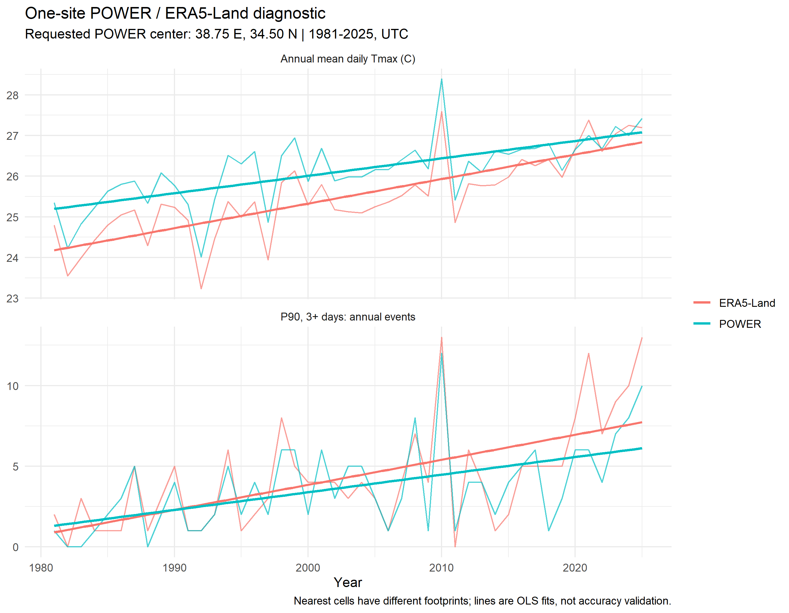
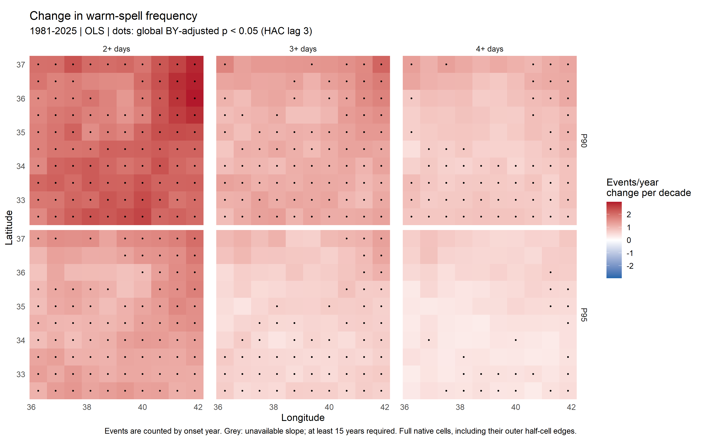
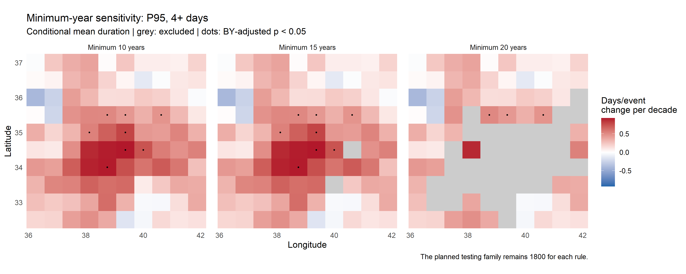

# Warm-spell definition sensitivity in R

An MSc methodology extension by **Mohammad Salloum**: how did the frequency and duration of relative warm spells change during 1981–2025, and how sensitive are the results to the percentile and minimum event length?

The workflow combines open climate data, calendar checks, consecutive-event detection, annual indices, trend estimation and explicit sensitivity analysis. It uses base R, **jsonlite** and **ggplot2**; **digest** verifies archived input bytes, and **sandwich** is used for reproducible checks.

## Connection to the MSc thesis

The project extends the percentile-and-persistence framework in *Climate Change Consequences and Scenarios: Syria as Case Study* (University of Tübingen, 2021, section 3.3.5, p. 45). It retains the **P90/P95 thresholds and 2/3/4-day event lengths**, together with the original extraction rectangle.

The data and estimand have changed: the thesis describes daily mean temperature series and a 1986–2005 baseline; this project studies historical **daily maximum temperature**, with a fixed **1991–2020** reference. It is a methodological extension, rather than a numerical reproduction or independent validation of the thesis results.

## Results

The primary POWER run contains **1,643,600 daily records**, **27,000 annual index rows**, and **1,800 planned primary trend cases**. With the 15-year rule, 1,798 primary p-values are estimable.

<!-- RESULTS_TABLE_START -->
| Definition | Frequency OLS | Frequency Sen | Event-day totals OLS | Mean-duration OLS | Duration fits |
| --- | ---: | ---: | ---: | ---: | ---: |
| P90, 2+ days | 2.0830 | 2.0263 | 8.3241 | 0.1795 | 100/100 |
| P90, 3+ days | 1.1772 | 1.1111 | 6.4625 | 0.2554 | 100/100 |
| P90, 4+ days | 0.7787 | 0.7020 | 5.2543 | 0.2945 | 100/100 |
| P95, 2+ days | 1.2273 | 1.1111 | 4.2325 | 0.1787 | 100/100 |
| P95, 3+ days | 0.6364 | 0.5000 | 3.1054 | 0.2606 | 100/100 |
| P95, 4+ days | 0.4196 | 0.0000 | 2.5362 | 0.3230 | 98/100 |

Values are spatial medians of cell-specific changes per decade, not an area-average fitted trend. Four decimals distinguish the two short-event duration medians (0.179495639 versus 0.178690976). Metric units are defined below.

| Definition | Frequency: BY cells | Event days: BY cells | Mean duration: BY cells |
| --- | ---: | ---: | ---: |
| P90, 2+ days | 95/100 | 87/100 | 9/100 |
| P90, 3+ days | 80/100 | 75/100 | 23/100 |
| P90, 4+ days | 61/100 | 60/100 | 16/100 |
| P95, 2+ days | 84/100 | 74/100 | 2/100 |
| P95, 3+ days | 57/100 | 43/100 | 2/100 |
| P95, 4+ days | 23/100 | 16/100 | 8/98 |

BY counts use one family of all 1,800 planned primary cases. Denominators are cells with estimable slopes; cells and nested definitions are correlated, so these counts are descriptive. Reproduce both tables from `results/definition_summary.csv`.
<!-- RESULTS_TABLE_END -->

The strongest common finding is an **OLS-based increase in frequency and event-day totals** across all six definitions. Effect size and statistical evidence depend on the definition. In the strictest frequency definition (P95, 4+ days), the spatial median Sen slope is zero despite a positive median OLS slope; agreement between estimators is therefore limited for that sparse count series.

The minimum-year comparison retains 600, 598 and 564 conditional-duration fits under the 10-, 15- and 20-year rules. The coverage loss occurs in P95/4+ days, where 100, 98 and 64 cells remain. Raising the rule from 15 to 20 changes one BY significance decision among shared fits. This check describes sensitivity to sample eligibility, not an independent validation of temperature accuracy.

### HAC bandwidth sensitivity

| Metric | Lag 2: BY cases | Lag 3: BY cases (primary) | Lag 6: BY cases |
| --- | ---: | ---: | ---: |
| Frequency | 414 | 400 | 397 |
| Event-day totals | 381 | 355 | 346 |
| Conditional mean duration | 60 | 60 | 72 |

Each lag uses the same planned family of 1,800 cases. Slopes and eligible samples are unchanged; only uncertainty estimates and decisions vary. Equal totals can conceal changes in which cells pass BY. `results/hac_lag_sensitivity.csv` also reports these decision changes relative to lag 3. Bandwidth checks do not establish finite-sample confidence-interval coverage.

### One-site comparison with ERA5-Land

The site is the POWER cell nearest the rectangle's midpoint, using longitude distances scaled by cosine latitude and a southern-latitude tie break: **38.75°E, 34.50°N**. This rule was fixed before inspecting trends. The returned ERA5-Land center is approximately 38.80°E, 34.50°N; its 0.1° footprint differs from the POWER cell.

For 1981–2025, [ERA5-Land](https://essd.copernicus.org/articles/13/4349/2021/) was accessed through [Open-Meteo](https://open-meteo.com/en/docs/historical-weather-api), explicitly selecting that model, nearest-cell selection, UTC days and no additional API elevation downscaling. The raw response, SHA-256 and request metadata are archived. Annual mean Tmax checks background warming without percentile thresholds. The retained P90/3+ definition compares spell frequency using each product's own calendar-day thresholds and the same 1991–2020 reference.

| Diagnostic | POWER OLS | ERA5-Land OLS |
| --- | ---: | ---: |
| Annual mean daily Tmax: °C/decade | 0.428 | 0.604 |
| P90/3+ annual frequency: events/year per decade | 1.092 | 1.552 |

Both trend directions agree, but magnitudes differ. This is a descriptive nearest-cell diagnostic, not a footprint-matched assessment of all 100 cells or independent station validation. The spell comparison retains the reference-period sampling limitation. Outputs are in `cross_product_annual.csv` and `cross_product_trends.csv`.



**Interpretation:** these are conditional, product-specific trends. Reference-period sampling effects and possible reanalysis inhomogeneity are not corrected here; see the limitations below.





## Conclusion and comparison with the MSc thesis

The results are **qualitatively consistent with the thesis' historical increase in hot days** (1980–2017; pp. 49–51). For 1981–2025, OLS warm-spell frequency slopes are positive in all 600 cell–definition cases; 400 pass the global BY correction. Spatial median changes range from **+0.42 to +2.08 annual events per decade** across definitions. Conditional mean-duration trends are mostly positive, but statistical evidence is less widespread: 60 of 598 eligible cases pass BY.

The thesis describes **daily mean temperature** from [GHCNd station records](https://www.ncei.noaa.gov/products/land-based-station/global-historical-climatology-network-daily) and [Berkeley Earth's station-based gridded reconstruction](https://berkeleyearth.org/methodology/) (pp. 32–33). This project uses **NASA POWER/MERRA-2 daily maximum temperature**, derived from hourly estimates on a 0.5° latitude × 0.625° longitude grid. [Reanalysis combines observations with an atmospheric model](https://power.larc.nasa.gov/docs/methodology/meteorology/); it is not a collection of local station measurements. Differences in variable, reference period (1986–2005 versus 1991–2020), analysis period and spatial treatment prevent direct numerical comparison.

The contribution is a **reproducible, spatially explicit historical extension through 2025**, with calendar-day thresholds and explicit definition and sample-coverage checks. The qualitative agreement is conditional on this product and uncorrected reference-period sampling effects; it does not verify the thesis' original event counts or future scenario estimates. The original inputs were not reprocessed here. The one-site ERA5-Land check shares the direction of change but does not validate regional temperature accuracy. Independent station validation is still needed to assess local temperature accuracy; coarse grids can smooth coastal and mountain extremes. Findings apply to the study rectangle, and mean-duration estimates remain conditional on event-bearing years.

## Run

Open a terminal in this folder, with R installed:

```sh
Rscript install_dependencies.R
Rscript run_analysis.R
```

In RStudio, set the working directory to this folder and run:

```r
source("install_dependencies.R")
source("run_analysis.R")
```

The default analysis verifies SHA-256 fingerprints and reads the **bundled, compressed NASA POWER responses**, without downloading the climate data again. The bundled snapshot takes precedence over any local RDS cache, so an old cache cannot override the authenticated release inputs. For inputs without a bundled snapshot, the cache is tried before the API. Changing the area or analysis years selects a different cache/snapshot key and can require API access. Change the settings at the top of `Heat.R`; keep the full reference period inside the analysis period. To disable only the optional archive integrity check, set `options(warmspell.verify_snapshot = FALSE)` before running; raw snapshot priority is unchanged. Hashes test byte integrity, not temperature accuracy or the authenticity of a manifest obtained from an untrusted source.

This release was checked with R 4.3.3, jsonlite 1.8.8, ggplot2 3.4.4, digest 0.6.39 and sandwich 3.1.0. The actual session is recorded in `results/sessionInfo.txt` and check dependencies in `results/checks.txt`.

`Heat.R` runs the primary analysis and bandwidth/common-year checks. `scripts/check_minimum_years.R` reuses its functions and annual indices to evaluate 10, 15 and 20 available-year rules. `scripts/summarise_results.R` writes the definition and HAC-bandwidth summary tables. `scripts/compare_era5_land.R` adds the archived one-site cross-product diagnostic. `run_analysis.R` runs all four stages. The optional check suite also recomputes these stages.

## Data and methods

| Choice | Specification |
| --- | --- |
| Input | NASA POWER `T2M_MAX`, degrees Celsius, UTC; 1981–2025 |
| Domain | 36–42°E, 32.5–37°N; 100 native cells, 0.625° longitude × 0.5° latitude |
| Reference | Fixed 1991–2020; calendar-day P90 and P95 in circular ±2-day windows; quantile type 8 |
| Leap day | Excluded from quantile fitting; threshold interpolated from 28 February and 1 March; observed 29 February retained in events |
| Event | A maximal consecutive run with Tmax **strictly above** its threshold, lasting at least 2, 3 or 4 days |
| Annual indices | Number of events, days in qualifying events, and conditional mean event duration |
| Primary change | OLS slope per decade; Sen slope as a descriptive robustness estimate |
| Uncertainty | Approximate pointwise HAC intervals and tests; Bartlett weights use actual calendar-year gaps |
| Eligibility | At least 15 available annual values; a pragmatic sparse-sample guard, checked against 10 and 20 |
| Multiplicity | BY at FDR 0.05 across all 1,800 planned primary cases, including unestimable cases |

Each cell must have exactly the expected daily dates, no duplicates or missing temperatures, and the expected units/time standard. Incomplete input stops the analysis instead of being silently imputed.

Events are detected before grouping by year. Event counts and full event durations belong to the **onset year**; event days belong to their **actual calendar year**. Years affected by a record-edge run are conservatively excluded. A genuine no-event year has count/day totals of zero and mean duration `NA`.

Conditional duration uses each definition's available event-bearing years. Common event-years are a secondary comparison. The primary HAC lag is 3 years, using `floor(4 * (45/100)^(2/9))`; lags 2 and 6 are retained as checks. Covariance uses the finite-sample factor `n/(n-2)` and t critical values with `n-2` degrees of freedom. These are approximate intervals, conditional on the fixed thresholds and product.

The rectangle is the original extraction domain, **not a Syria boundary or a land-only mask**. Results apply to the returned cells. Maps show complete native cell footprints: the actual center-coordinate range is expanded by half a cell (0.3125° longitude, 0.25° latitude). The default display extent is 35.9375–42.1875°E and 32.25–37.25°N. No additional cells enter the calculations.

## Outputs

All outputs are written to `results/`:

- `heatwave_annual.csv`: one row per cell, year and definition.
- `heatwave_trends.csv`: primary slopes, coverage, pointwise intervals, p-values and BY adjustments.
- `heatwave_trend_checks.csv`: alternative HAC lags and common-year duration fits; exploratory checks without an additional adjusted testing family.
- `minimum_years_trends.csv` and `minimum_years_sensitivity.csv`: complete eligibility-rule comparisons and their summary.
- `definition_summary.csv` and `hac_lag_sensitivity.csv`: full-precision median slopes, BY cell counts and bandwidth decision changes.
- `checks.txt`: report from running `tests/run_checks.R`.
- Six PNG figures: three trend maps, duration coverage, minimum-year sensitivity, and the one-site cross-product comparison.
- `cross_product_annual.csv` and `cross_product_trends.csv`: annual series and descriptive OLS/Sen slopes for the two products at the selected site. No extra p-values or BY decisions are reported for this diagnostic.
- `analysis_settings.rds` and `sessionInfo.txt`: settings and the actual R session.

Slope units are **events/year per decade** for frequency, **event-days/year per decade** for day totals, and **days/event per decade** for conditional mean duration. Grid cells and nested definitions are correlated; counts of positive or significant cases are descriptive summaries.

## Scope and checks

Reproduce the implementation checks from the repository root:

```sh
Rscript tests/run_checks.R
```

The command recomputes the workflow and then checks cross-year event/day accounting, zero-event duration, record-edge exclusions, leap-day handling and the minimum-year guard. Complete-series HAC standard errors, intervals and p-values are compared with `sandwich::NeweyWest` (`prewhite = FALSE`, `adjust = TRUE`); gapped samples are checked against a separate full-matrix calendar-lag covariance calculation. A disposable-file check demonstrates that the snapshot verifier rejects altered bytes. The report is saved to `results/checks.txt`. These checks validate implementation and input integrity, not the accuracy of the climate product.

**Reference-period sampling:** the 1991–2020 observations estimate thresholds and are then classified using those same thresholds; 1981–1990 and 2021–2025 are out-of-base samples. Threshold sampling can create artificial in-base/out-of-base discontinuities, as described by [Zhang et al. (2005)](https://doi.org/10.1175/JCLI3366.1). No in-base bootstrap correction is implemented. An alternative reference period would test sensitivity but would not by itself remove this mechanism. Trends therefore remain exploratory with respect to this effect; the HAC intervals do not account for it.

**Reanalysis homogeneity:** POWER is a gridded MERRA-2-derived product and can smooth local extremes, particularly in coastal and mountainous settings. Changes in assimilated observing systems can also introduce temporal inhomogeneity and affect trend estimates; this is a separate issue from grid smoothing ([Gelaro et al., 2017](https://doi.org/10.1175/JCLI-D-16-0758.1)). This analysis has not established whether such effects materially affect these cells. The one-site ERA5-Land diagnostic above is a limited cross-product comparison, not regional homogeneity testing or independent station validation. Agreement among event definitions and products does not remove product-specific or shared biases.

**Small-sample inference:** OLS/HAC intervals with t critical values are approximate, including for the full 45-year record and especially for conditional-duration samples with fewer event-bearing years. The 15-year rule is a pragmatic eligibility guard. Checks at lags 2, 3 and 6 assess bandwidth sensitivity; they do not guarantee nominal interval coverage or eliminate small-sample size distortion. BY adjusts the supplied p-values but does not repair an inadequately calibrated test.

These full-year relative spells include winter warm anomalies; they are not health-risk thresholds or standard six-day WSDI. No climate attribution or future scenario modelling is performed. Intervals exclude threshold-estimation and product uncertainty.

## Data provenance, references and licence

The 45 annual API responses are archived in `data/power_snapshot/` as gzip JSON. `data/snapshot_manifest.csv` records SHA-256 hashes of both the archived files and their original JSON, API version and time standard. The archive was packaged for this release on 2026-10-25; the original download timestamp was not retained. Cache files are excluded from Git.

Data acknowledgement: **NASA POWER Project**, supported through NASA's Applied Sciences Program at NASA Langley Research Center. The included responses identify MERRA2 and POWER as sources and POWER Daily API v2.10.1. The MIT licence in `LICENSE` applies to project code; data attribution and NASA's source terms remain applicable.

- [NASA POWER meteorological data and native resolution](https://power.larc.nasa.gov/docs/methodology/meteorology/)
- [NASA POWER daily API, including UTC requests](https://power.larc.nasa.gov/docs/services/api/temporal/daily/)
- [NOAA GHCNd station-data overview](https://www.ncei.noaa.gov/products/land-based-station/global-historical-climatology-network-daily)
- [Berkeley Earth station-based reconstruction methodology](https://berkeleyearth.org/methodology/)
- [Climdex percentile/spell index definitions](https://www.climdex.org/learn/indices/)
- [Newey–West estimator documentation](https://search.r-project.org/CRAN/refmans/sandwich/html/NeweyWest.html)
- [R multiple-testing adjustments](https://stat.ethz.ch/R-manual/R-patched/library/stats/html/p.adjust.html)

- [Zhang et al. (2005): in-base/out-of-base sampling in percentile indices](https://doi.org/10.1175/JCLI3366.1)
- [Gelaro et al. (2017): MERRA-2 system and remaining limitations](https://doi.org/10.1175/JCLI-D-16-0758.1)

The supplementary ERA5-Land response is archived in `data/era5_land_snapshot/`, with the exact request, returned coordinates, download time and SHA-256 in `metadata.json`. The comparison script verifies this SHA-256 before use. For a different area or unsupported dates, the diagnostic is skipped with an explicit message; the primary analysis remains configurable.

ERA5-Land acknowledgement: Copernicus Climate Change Service / ECMWF, accessed through Open-Meteo. The diagnostic uses Open-Meteo daily aggregates of ERA5-Land temperature; source data terms remain applicable, separately from the code licence.

- [Muñoz-Sabater et al. (2021): ERA5-Land](https://doi.org/10.5194/essd-13-4349-2021)
- [Open-Meteo Historical Weather API and processing options](https://open-meteo.com/en/docs/historical-weather-api)
